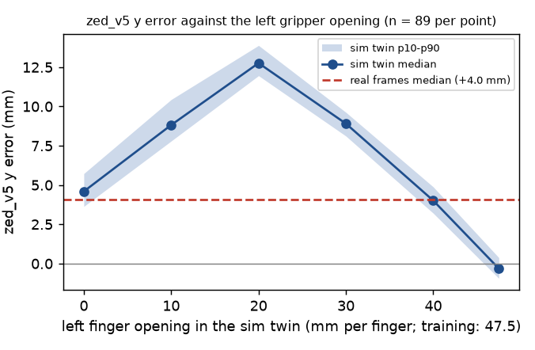

# Two perception biases: zed_v5 y offset and the wrist-net up bias (2026-11-15)

Task: find the cause of (A) the fixed +4..+6 mm y offset of the ZED PC net zed_v5 on real frames and (B) the run-to-run change of the wrist-net "up" bias at the align hand-over (+0.5..+3.6 mm). Worker on mason, GPU 3, no rig access. **Nothing here has run on the arm.** No existing config, asset default or weight changed. Sim numbers are sim only. Every number has its n.

## Summary

- **A, cause: the scene around the PC, not the PC; for zed_v5 mostly the left gripper.** zed_v5 was trained with the left gripper always at one opening (fully open, 47.5 mm per finger). It uses the gripper's yellow finger pad, next to the lower-left corner of the PC, as a landmark. The real left gripper at the capture pose does not show that pad there. In a sim twin of each real capture frame (same PC pose, same logged arm angles), zed_v5 reads y -0.3 mm with the training opening and **+4.0..+12.8 mm with any other opening** (n = 89 per opening). The real frames read +4.0 mm against the same truth.
- The PC geometry error (hypothesis 1) gives only +0.4 mm y (and +3.5 mm x). The camera path (hypothesis 2) is correct: the logged policy image equals the crop of the raw frame (shift < 0.005 px), and the sim camera uses the calibrated intrinsics and extrinsics. The label frame (hypothesis 3) adds 0 mm (sim twin label = edge-fit pose to 0.001 mm).
- **A, retrain zed_v6 does not fix it.** zed_v6 = zed_v5 recipe + finger openings drawn per world + arm jitter + the measured PC geometry (2 seeds, about 1 GPU h). It is unbiased in the sim twins with open and closed fingers (|dx|, |dy| <= 0.34 mm, n = 89) and follows real PC moves (change error <= 1.3 mm, n = 5), but on the real frames it reads **x -7.7, y +7.2 mm against the arm port (n = 41 runs)**, worse than zed_v5 (x -1.3, y +4.5). With the gripper cue gone, the offset comes from many parts of the scene outside the PC (swap test: real frame with the sim PC still -7.3, +5.7 mm). **Do not use zed_v6.** The case-edge fit (`zed_edge_refine`, `ZED_EDGEFIT_20261115.md`) stays the PC pose to use.
- **B, a grasp variable explains most of it.** The up bias follows the height of the plug in the jaws, measured by port vision as the plug tip y in the wrist camera at the align stop (camera fixed to the hand): Spearman rho +0.65, Pearson +0.80, n = 40 runs; on the 25 hand-over runs rho +0.40, Pearson +0.80 (the Pearson value leans on one run, `demo_1`). The in-hand net, an independent estimate, confirms the grasp variable (tip y against in-hand net rho +0.56 / -0.57, n = 40). Brightness, gap, arm pose and the grasp rotation do not explain it.
- **B, correction (off by default):** `align.secondary.bias_model` = up offset 0.03 + 0.395 x (plug tip y at the stop), clipped to 0..4 mm. Replay on 25 real hand-overs: the residual the +/-3.5 mm gate sees is **-0.54..+1.19 mm** (leave-one-run-out -0.60..+1.23), against -2.79..+0.96 mm with today's fixed 2.6 mm. Config `deploy/config/bimanual_align10_all_netgrasp.json`, **needs operator approval**.

## Part A: zed_v5 y offset

### Method: sim twins of the real capture frames

`scripts/perception/zed_bias_render.py`. For each of the 89 real run capture frames (2026-11-01..13, `results/placement/zed_map/frames.json`) the sim renders a twin: PC at the case-edge fit pose, both arms at the logged believed capture angles (`arms_b`), right fingers at the logged opening, left fingers open (as on the rig: `full_open_m` 47.5 mm), nominal visual look. Then zed_v5 and v1 run on the twin and on the real frame. Options (all opt-in, load-time patches for one process): `--geom real` (`pc_geom_patch.py`), `--panel dark` (the panel photo material darkened), `--real-look` (real panel and lid textures), `--left park`, `--left-fingers M`.

Truth: the edge fit in the geometry of the sim PC (`edge_sim`) for the sim-geometry twins, `edge_real` (physical port 2) for the real-geometry twins.

### Results (zed_v5, medians, n = 89 frames each; x, y mm)

| Twin | zed_v5 on twin minus truth | real minus twin |
|---|---|---|
| sim PC, left open (the training condition) | +0.29, **-0.32** | -3.63, **+4.40** |
| sim PC, dark panel | +3.13, -1.81 | -6.55, +5.96 |
| real geometry, left open | +3.19, +0.11 | -4.62, +4.12 |
| real geometry, dark panel | +6.16, -1.22 | -7.48, +5.39 |
| sim PC, real panel and lid textures | +0.55, +1.05 | -3.96, +3.03 |
| sim PC, **left fingers closed** | -0.30, **+4.59** | -3.32, **-0.84** |
| sim PC, left arm parked | +0.90, +2.86 | -4.46, +1.04 |
| real geometry, left closed | +2.54, +5.28 | -4.11, -1.25 |
| real geometry, left closed, dark panel | +2.50, +3.60 | -3.98, +0.25 |
| real geometry, left closed, real textures | +0.75, +5.08 | -2.22, -1.29 |

Real frames against the same truth: x -3.38, y +4.05 (sim convention); x -1.49, y +4.35 (physical port).

Left finger opening sweep (sim PC, n = 89 per point; `finger_sweep.png`):

| Left opening (mm per finger) | 0 | 10 | 20 | 30 | 40 | 47.5 (training) |
|---|---|---|---|---|---|---|
| zed_v5 y error, median (mm) | +4.59 | +8.82 | +12.76 | +8.91 | +4.01 | -0.32 |



### Image swaps (`scripts/perception/zed_bias_swap.py`, n = 89)

| Image | zed_v5 minus truth (x, y mm) |
|---|---|
| real | -3.38, +4.05 |
| twin | +0.29, -0.32 |
| twin with the real PC pasted in (PC region from the calibration) | +4.00, -0.68 |
| real with the twin PC pasted in | -5.58, +4.71 |

- The y offset stays when the PC region is the sim's and goes when it is the real one. So the y offset comes from outside the PC.
- Patch map (each 16 px patch of the real frame replaced by the twin's patch, one at a time; mean change of y): one patch, just below-left of the PC (u 112-128, v 200-216 px of the 320 px frame), moves y by **-11.4 mm**. It holds the sim left finger pad (yellow) and, on the real frame, a dark finger. Every other patch moves y by less than 2.4 mm. Figure: `swap_sim.png`.
- The x offset is the PC appearance (twin with the real PC: x +3.7 mm). Its sign and size depend on the panel and lid look and the geometry; no single variant removes it.

Side remark: with the colour channels swapped (BGR into the net), zed_v5 reads y +4 mm more. The net is very sensitive to colour. The logged policy pngs must be read with `cv2.cvtColor(..., COLOR_BGR2RGB)` (as `zed_map.py` does).

### Reading

- zed_v5 trained at `vary_arms 0`: every training image had the left gripper fully open at one place. The net learned the pad as part of the scene near the PC corner. Any change of that patch moves y by up to 13 mm.
- The real left gripper at the capture pose is commanded fully open, but its image near the PC corner matches the sim closed gripper (real minus closed twin y -0.84 mm), not the open one. Either the real "fully open" differs from the sim's, or the real finger hides the pad from the ZED. The left gripper is not calibrated (`gripper.left: g_reader null, "uncalibrated (proportional)"`).
- This also explains the zed_gt frames with the left arm parked: real +3.0..+3.8 mm, twin parked +2.86 mm. It does not explain zed_v5a (arms and fingers varied, `vary_arms 0.7`), which read +4..+9 mm on real frames: so the real gripper image is not simply one sim opening; a net that ignores the gripper is needed (zed_v6 tests this).
- Hypothesis 1 (PC geometry) gives +0.4 mm y, +2.9 mm x. Hypothesis 2 (camera path) is clean. Hypothesis 3 (label frame) is 0. The panel colour moves x (+2.8 mm) and y (-1.5 mm) of the twin; it is a real gap but not the cause of the y offset.
- Caliper assumption: the real case 103.5 mm along the panel x 103 mm deep, port 2 19.8 mm from the case centre toward +y (from the ZED edge fit and the wrist panel model, `ZED_MAP_20261114.md`). The operator's caliper numbers are not in yet.

### zed_v6

`scripts/perception/train_zed_v6.py` (new names only: `runs/perception/zed_v6s0.pt`, `zed_v6s1.pt`, `runs/perception/zed_v6/`). The zed_v5 recipe (layout `task_layout_real_v2`, box +/-40 mm, +/-20 deg about (231, 394) mm, crop (96, 72, 160), 49152 renders, 40 epochs, seeds 20 and 21) plus:
- per world, the left and right finger openings uniform 0..47.5 mm;
- arm joint jitter about the capture pose, N(0, 0.03 rad) left, N(0, 0.02 rad) right;
- the measured PC geometry (`pc_geom_patch.py`); labels = the physical port 2 (the frame of the edge fit 'real' and of the arm).

Time: about 5 min data, about 50 min training per seed (two seeds in parallel on GPU 3). Sim held-out error at the last epoch (DR, seed 0): x 0.85, y 0.64 mm, yaw 0.23 deg.

Results (`scripts/perception/zed_v6_replay.py`, `zed_v6_replay.json`; pose only, zed_v6 has no gate; x, y mm, medians):

| Frames | n | zed_v6 | zed_v5 | v1 |
|---|---|---|---|---|
| sim twins, real geometry, left open | 89 | -0.34, -0.01 | (+3.19, +0.11) | - |
| sim twins, real geometry, left closed | 89 | -0.18, -0.13 | (+2.54, +5.28) | - |
| sim twins, real geometry, left closed, dark panel | 89 | -0.80, -0.81 | (+2.50, +3.60) | - |
| real run frames against the edge fit | 89 | **-7.86, +7.41** (max 13.1) | -1.49, +4.35 (max 7.9) | +0.54, -2.94 (max 14.6) |
| real runs against the arm port | 41 | **-7.66, +7.19** (y +3.2..+9.7) | -1.33, +4.50 (y +3.6..+7.2) | +0.74, -3.08 |
| zed_gt frames against the edge fit | 18 | -8.35, +8.03 | +3.20, +3.19 | +4.25, +0.71 |
| mapping poses, pose-change error (max) | 5 | 1.3 mm, 1.2 deg | 2.4 mm, 1.0 deg | 8.8 mm |

- Slope against the edge truth (x, y, yaw; n = 89): zed_v6 1.01, 0.88, 0.97; zed_v5 0.90, 1.02, 0.92.
- The two seeds disagree by 3.3 mm (p50, max 5.4 mm) on the real frames: the real frames are out of the training distribution.
- Swap test for zed_v6 (`zed_bias_swap.py --pose-nets zed_v6s0 zed_v6s1`, n = 89): real -7.86, +7.41; twin -0.34, -0.01; twin with the real PC +0.37, +1.70; real with the twin PC -7.31, +5.65. The patch map has no single dominant patch (largest -4.1 mm y at the upper right of the crop, the far table edge and the right gripper; +3.3 mm at the lower-left PC corner). The gap is spread over the scene around the PC.

Conclusion: removing the gripper cue is necessary but not enough. The sim scene around the PC (arms, cables, table, light) differs enough from the real one to move a net trained on renders by 5-10 mm. What a working retrain would need (not started; each about 1-2 GPU h):
1. Arm masks in training and at run time (`perception/arm_mask.py` exists; `ZedEstimator` already gets the arm angles; a deploy change, off by default), plus table and light DR around the PC; or a tighter crop around the PC with the arms masked.
2. A fine-tune on the real capture frames with edge-fit labels (107 frames, about 25 placements; hold out 2026-11-13), mixed with renders. Pass: |error| <= 2 mm on every held-out frame, pose-change error <= 1 mm.
The edge fit already gives +0.7 mm y, 0.0 mm x against the arm (n = 41) without a net. A net is needed only as the start pose and the presence gate, which zed_v5 already does.

## Part B: wrist-net up bias at the hand-over

### Data and method

`scripts/real/wrist_bias_correlates.py --pv`. Every real run with align measurements and the secondary net `wrist_r10f_ft_abs` (2026-11-03, 11-06, 11-10, 11-11, 11-13): 40 runs with a measurement at a vision gap <= 10 mm, 685 measurements, 25 runs with a hand-over. Per run: d_up = raw net up minus port-vision up, median over the measurements at gap <= 10 mm (and the value at the last measurement). The raw net output is the logged `net` event of the same tick (no bias subtracted). Covariates:
- grasp height of the reader in the jaws: port vision re-run on the raw right wrist frames, plug tip in the camera frame (`tip_cam`, mm; the camera is fixed to the hand), at the hand-over measurements and at the align stop (the 9 prepare frames); shell width and depth;
- reader tilt: port-vision plug rotation (`rv_deg`), the net's own rotation outputs, the pick grasp rotation (`grasp_v3 squeeze_end rot_deg`), the in-hand net (`inhand_ih5`) and the align in-hand refresh;
- gap to the port, the port-vision up value, confidence and sigma;
- image brightness: mean grey of the right wrist policy frame and of the net's crop;
- arm pose: q_b joints 1-6, grip reading.

### Results

Spearman rho with d_up (all 40 runs; hand-over runs n = 25). Full table: `wrist_bias.json` (`corr`, `corr_handover`); figure `wrist_bias.png`.

| Covariate | rho, 40 runs | rho, 25 hand-over runs | Note |
|---|---|---|---|
| **plug tip y in the camera at the stop** (grasp height) | **+0.65** (p < 0.001), Pearson +0.80 | +0.40 (p 0.05), Pearson +0.80 | stop and hand-over values agree (r 0.99) |
| plug tip z in the camera (reader depth along the view) | +0.66 | +0.25 | correlated with tip y (rho +0.51) |
| net rotation ry | +0.53 | +0.51 | the net's own output: an error mode of the net, not a cause |
| vision gap at the hand-over | +0.43 | +0.54 | date confound: within a run the bias falls with the gap (rho -0.35, slope -0.04 mm/mm, n = 685) |
| wrist frame brightness (crop) | -0.15 | -0.09 | no |
| vision up | - | +0.01 | no |
| grasp rotation at the squeeze | -0.11 | -0.09 | no |
| arm joints q3, q4 | -0.44, +0.46 | -0.12, +0.17 | date confound, not in the hand-over runs |

- The plug tip y at the stop is a grasp variable, not vision noise: it agrees with the in-hand net, an independent net on the approach frame (rho +0.56 with in-hand x, -0.57 with in-hand z, n = 40), and with the align in-hand refresh (rho +0.62, -0.66, n = 22). It does not correlate with the vision up value (rho +0.03).
- Range: tip y -1.6..+8.1 mm. Four grasps sit low (tip y < 2.5 mm: `demo_1` and three 2026-11-03 runs) and have the lowest d_up (-4.2..+1.3 mm). In the main cluster (tip y 4-8 mm, n = 36) rho is +0.60 (p < 0.001), slope 0.54 mm per mm.
- Not explained: the 2026-11-13 align-only runs `fastalign_align_1` (+0.53 mm) and `all9_align_2` (+1.83 mm) sit 1.0-1.7 mm below the model. Within a run the bias also rises by about 0.5 mm as the gap closes from 20 to 6 mm.

### Correction (off by default) and replay

Code (`deploy/bimanual/align.py`, all paths inactive unless `align.secondary.bias_model` is set):
- `stop_tip_y()`: median plug tip y over the still prepare frames at the stop (`port_vision.measure` debug `tip_cam`), one value per grasp, before any align step.
- `PortVisionSource.prepare` computes it only when the stage asks (flag set by `AlignStage.__init__` when the secondary has a `bias_model`); the `align_prepare` event logs `stop_tip_y_mm`.
- `WristNetSource.cur_bias()`: up offset = `a_mm + b * stop_tip_y`, clipped to `clip_mm`; across and gap keep `bias_mm`; without a stop value the offset stays `bias_mm` (today's behaviour). Unknown kinds or keys raise.

Fit on the 25 hand-over runs: a 0.03 mm, b 0.395, clip 0..4 mm. Replay (`scripts/real/wrist_bias_replay.py`, the raw up difference at the last measurement before the hand-over minus the offset; gate +/-3.5 mm; n = 25):

| Offset | Residual min..max (mm) | SD | Over the gate | Smallest margin |
|---|---|---|---|---|
| none (raw) | -0.19..+3.56 | 0.80 | 2 | -0.06 |
| fixed 2.6 mm (`bimanual_align10_all`) | -2.79..+0.96 | 0.80 | 0 | 0.71 |
| **grasp model** | **-0.54..+1.19** | 0.51 | 0 | 2.31 |
| grasp model, leave-one-run-out fit | -0.60..+1.23 | 0.54 | 0 | 2.27 |

Without `demo_1` the gain is smaller: leave-one-out residual -0.99..+0.95 mm against -1.45..+0.83 mm for the fixed offset (n = 24).

Code check on real logged frames (`scripts/real/wrist_bias_codecheck.py`, 3 runs): `stop_tip_y` reproduces the analysis value exactly; the offset is 2.39 (`all9b_full_1`), 0.00 (`demo_1`), 3.09 mm (`k4_1`); without the model the offset equals `bias_mm`. `FAILED: none`. The analysis ran port vision without the shell reference; the config has `shell_ref` on, which changes the shell edges only on frames with a bright patch (16 of 4824 real frames).

Config `deploy/config/bimanual_align10_all_netgrasp.json` = `bimanual_align10_all` + `align.secondary.bias_model`. Conventions check: `FAILED: none`. The dry run has no secondary source (sim truth only), so it cannot exercise the model; it checks that the chain is unchanged. Dry runs (`results/placement/perception_bias/dry/`): seed 7043 aligned (15 cycles, 13.5 s), push 14 N, seated and seated after the release; seed 7045 aligned (10 cycles, 4.1 s), push skipped (depth 4.80 < 5.0 mm), seat detected, not seated after the release (the known sim release effect; `bimanual_align10_all` seed 7045 does the same, FINDINGS 2026-11-14).

### Limits

- n = 25 hand-over runs, one PC spot family, one reader strip. The fit leans on 4 low grasps; in the main cluster the evidence is moderate (rho +0.60, n = 36).
- The model takes the grasp height from the primary source (port vision) at the stop. A wrong shell detection at the stop shifts the offset by 0.4 x its error. The shell depth gate (113.5-123.5 mm) and the shell reference limit that.
- The proper fix is the one already proposed: retrain the wrist net on the real align frames, with the in-hand plug pose in the labels.

### One measurement that settles it on the rig

Two runs with the same PC spot and two different, known grasp heights: re-seat the reader in the jaws by hand after the pick (press it 2-3 mm deeper or shallower; the stop prints `stop_tip_y_mm` with the shadow config), then run the align stage in measure mode. The model predicts the d_up change as 0.4 x the tip y change. Pass: the measured change is within +/-0.5 mm of the prediction.

## Runbook (rig)

Nothing here needs motion beyond today's approved chain, except where marked.

```bash
git pull
for c in bimanual_align10_all_netgrasp; do echo "$c: $(.venv/bin/python -m deploy.checks.bimanual_conventions --config deploy/config/$c.json | tail -1)"; done   # FAILED: none
PYTHONPATH=. .venv/bin/python scripts/real/wrist_bias_codecheck.py | tail -1                                                            # FAILED: none (needs the real logs; mason only)
```

1. **Left gripper picture (no motion, 1 min):** at the capture pose, take a photo of the left gripper from above (or save the ZED frame). Note whether the left fingers are fully open and where the yellow pads are. This settles why the real gripper differs from the sim.
2. **zed_v6: not for the rig** (7-8 mm off on real frames). Every capture frame is still useful: on mason run `scripts/perception/zed_v6_replay.py` (and `zed_bias_render.py` / `zed_bias_swap.py`) on new captures.
3. **Grasp-height offset (needs approval):**
   ```bash
   .venv/bin/python -m deploy.run_bimanual --stage full --align-mode full --speed 0.75 --demo --config deploy/config/bimanual_align10_all_netgrasp.json --name netgrasp_1
   ```
   Pass: the `align_prepare` line shows `stop_tip_y_mm` 4-8 mm (else write it down), no disagreement stop, and the logged `second` up minus vision up within +/-1.5 mm at the hand-over. Stop: a disagreement stop, or `stop_tip_y_mm` missing on 2 runs (the offset then falls back to 2.6 mm, still safe).

## Approvals needed

| Item | Change | Data |
|---|---|---|
| `bimanual_align10_all_netgrasp` | The wrist-net up offset changes per grasp (0..4 mm, from the plug height at the stop) in place of the fixed 2.6 mm. Today the accepted raw up difference is -0.9..+6.1 mm. With the model it is (offset - 3.5)..(offset + 3.5): for a low plug (tip y < 6.5 mm) the lower end moves down to -3.5 mm (offset 0); for a high plug (tip y > 6.5 mm) the upper end moves up to +7.5 mm (offset 4). Gate widths unchanged. | Part B replay, n = 25 |

Variant inside today's limits: `bimanual_align10_all` itself (fixed 2.6 mm). The model cannot keep the accepted window inside -0.9..+6.1 mm without also changing the gate width.

## Files

- `scripts/perception/zed_bias_render.py`: sim twins of the real capture frames (variants opt-in).
- `scripts/perception/zed_bias_swap.py`: PC swap and patch map.
- `scripts/perception/train_zed_v6.py`, `scripts/perception/zed_v6_replay.py`: zed_v6 training and real-frame replay.
- `scripts/perception/zed_bias_figs.py`: figures.
- `scripts/real/wrist_bias_correlates.py`, `wrist_bias_replay.py`, `wrist_bias_codecheck.py`: Part B.
- `deploy/bimanual/align.py`: `stop_tip_y`, `WristNetSource.bias_model` / `cur_bias`, the prepare hook (off by default).
- `deploy/config/bimanual_align10_all_netgrasp.json`.
- `scripts/perception/zed_v6_swap.py`: PC swap for a named net.
- `runs/perception/zed_v6s0.pt`, `zed_v6s1.pt`, `runs/perception/zed_v6/` (new; not for the rig).
- `results/placement/perception_bias/`: `twin_*.json` (twin results per variant), `swap_sim.json/.png`, `swap_v6.json/.png`, `finger_sweep.png`, `wrist_bias.json/.png/.log`, `wrist_bias_replay.json`, `zed_v6_replay.json`, `dry/`.
